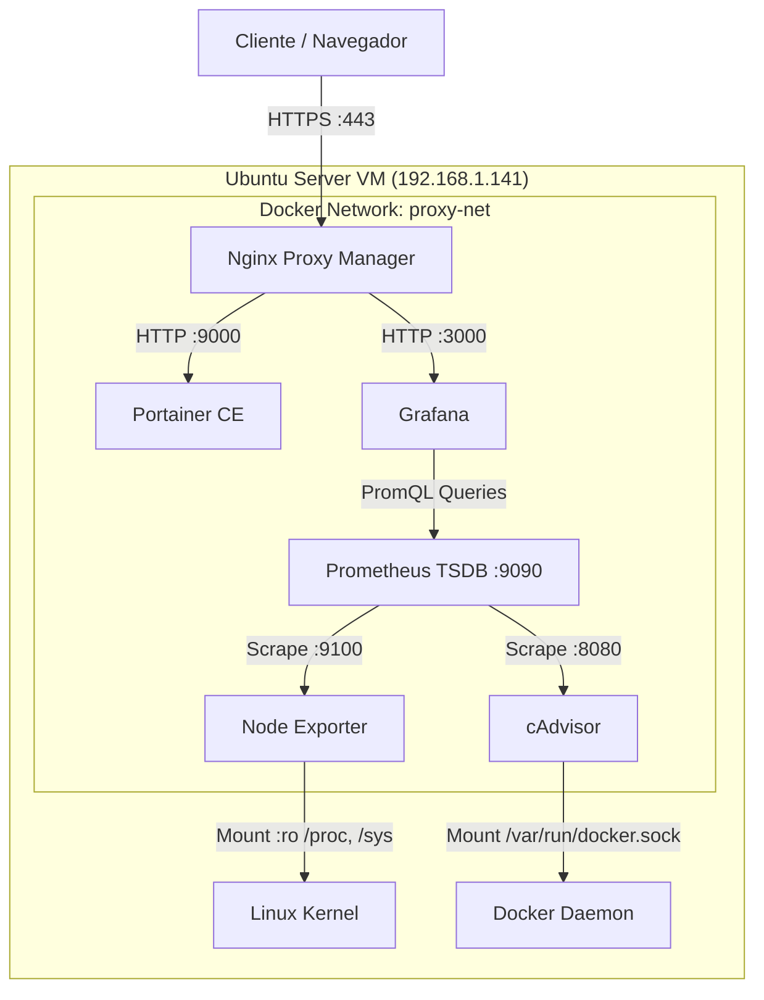

# homelab-infraestructura

[](https://www.docker.com/)
[](https://docs.docker.com/compose/)
[](https://ubuntu.com/)
[](https://nginxproxymanager.com/)
[](https://prometheus.io/)
[](https://grafana.com/)

Infraestructura contenerizada autoalojada y pila de observabilidad integral desplegada sobre una máquina virtual dedicada con Ubuntu Server. Diseñada bajo principios de **aislamiento de red**, **terminación TLS centralizada** y **mínimo privilegio de puertos expuestos**.

---

## Arquitectura de Red y Servicios

El tráfico externo hacia los servicios es canalizado a través de una red puente interna (`proxy-net`). Los puertos de las aplicaciones (`9000`, `3000`, etc.) no están enlazados al host (`ports`), sino aislados mediante `expose`, dejando como únicos puntos de entrada los puertos estándar `80` y `443` operados por **Nginx Proxy Manager**.



## Componentes del Stack

1. Núcleo de Enrutamiento y Gestión (core)

    Nginx Proxy Manager: Punto único de entrada (Reverse Proxy) que gestiona la terminación TLS mediante un certificado wildcard autofirmado (*.homelab.local).

    Portainer CE: Interfaz visual para la inspección de ciclos de vida de contenedores, volúmenes y redes comunicándose vía Unix Domain Socket (/var/run/docker.sock).

2. Pila de Monitoreo y Métricas (monitoring)

    Node Exporter: Agente a nivel de host que expone métricas de hardware y del kernel de Linux (CPU, saturación I/O, memoria, interfaces de red).

    cAdvisor: Demonio de Google que recopila el uso de recursos y perfiles de rendimiento individual de cada contenedor Docker.

    Prometheus: Base de datos de series temporales (TSDB) configurada para recolectar métricas (scraping) de los exportadores cada 15 segundos.

    Grafana: Motor de visualización analítico conectado a Prometheus con dashboards dinámicos para el sistema anfitrión y los contenedores.

## Estructura del Proyecto

El despliegue está dividido en proyectos de Docker Compose independientes para permitir el mantenimiento y reinicio modular de las pilas sin interrumpir el proxy de tráfico:

```plaintext
.
├── core/
│   └── docker-compose.yml       # NPM y Portainer
├── monitoring/
│   ├── docker-compose.yml       # Prometheus, Grafana, Node Exporter, cAdvisor
│   └── prometheus/
│       └── prometheus.yml       # Objetivos y frecuencias de scraping
├── scripts/
│   └── generate-certs.sh        # Generación de certificados OpenSSL
└── docs/
    └── screenshots/             # Capturas de paneles operativos
```

## Despliegue Rápido (Runbook)
### Prerrequisitos
Ubuntu Server con Docker Engine y Docker Compose v2+ instalados. Red Docker compartida creada previamente:

```bash
docker network create proxy-net
```

## 1. Certificados SSL Locales (Wildcard)
   Genere la clave privada y el certificado X.509 autofirmado para cubrir todos los subdominios de la red local:

```bash
   openssl req -x509 -nodes -days 365 -newkey rsa:2048 \
  -keyout ./certs/homelab.key \
  -out ./certs/homelab.crt \
  -subj "/CN=*.homelab.local"
```

## 2. Despliegue de Servicios
Levantar la pila de gestión y proxy inverso:

```bash
cd core
docker compose up -d
```

Configurar los permisos del volumen de almacenamiento de Grafana e iniciar la pila de observabilidad:

```bash
cd ../monitoring
sudo chown -R 472:472 ./grafana/data
sudo chmod -R 775 ./grafana/data
docker compose up -d
```

## 5. Resolución DNS Local
En el equipo cliente (estación de trabajo), agregue las entradas al archivo /etc/hosts (o C:\Windows\System32\drivers\etc\hosts en Windows):

```plaintext
192.168.1.141 npm.homelab.local portainer.homelab.local grafana.homelab.local
```

## 6. Configuración del Reverse Proxy
Desde la interfaz de Nginx Proxy Manager (http://192.168.1.141:81), instale el certificado en SSL Certificates > Custom y configure los siguientes Proxy Hosts:

**Dominio**: portainer.homelab.local	          **Esquema**: http	   **Host de reenvío**: portainer	        **Puerto**: 9000	      **Opciones**: Websockets, Force SSL

**Dominio**: grafana.homelab.local	            **Esquema**: http	  **Host de reenvío**: grafana	          **Puerto**: 3000	      **Opciones**: Websockets, Force SSL

## Resolución de Incidentes y Lecciones Aprendidas

Esta sección recopila los problemas técnicos reales encontrados durante la fase de despliegue e integración:
1. Conflicto de enlaces en puertos 80/443 (Apache vs Docker Proxy)

    Incidente: Al acceder al servidor, el navegador devolvía la página predeterminada de Apache ("Apache2 Ubuntu Default Page") en lugar de Nginx Proxy Manager.

    Diagnóstico: Inspección de sockets abiertos con sudo ss -tulpn | grep -E ':(80|443)\s', revelando que el demonio apache2 estaba activo en el sistema host escuchando en todas las interfaces (0.0.0.0:*), impidiendo a Docker enlazar los puertos.

    Mitigación: Parada, deshabilitación y purga completa del servicio Apache en la máquina anfitriona para asegurar que únicamente docker-proxy gestione la entrada de tráfico web:

```bash
sudo systemctl stop apache2 && sudo systemctl disable apache2
sudo apt purge -y apache2 apache2-bin
```

## 2. Fallo de arranque y HTTP 502 Bad Gateway en Grafana

  Incidente: Nginx Proxy Manager no lograba establecer conexión con el backend de Grafana, respondiendo con un error HTTP 502.

  Diagnóstico: El comando docker ps -a reportó a Grafana en estado Restarting (1). El análisis de registros mediante docker logs grafana --tail 30 indicó un fallo crítico: GF_PATHS_DATA='/var/lib/grafana' is not writable: Permission denied.

  Causa Raíz: El contenedor oficial de Grafana corre bajo un usuario sin privilegios de root con UID predeterminado 472. El volumen local montado fue creado inicialmente por el usuario del sistema anfitrión, bloqueando el acceso de escritura.

  Mitigación: Ajuste recursivo de propiedad sobre el directorio persistente (sudo chown -R 472:472 ./grafana/data), normalizando el estado a Up de forma estable.

## Dashboards de Grafana Recomendados

Una vez conectado Prometheus como DataSource (http://prometheus:9090), importe los siguientes identificadores de dashboard oficiales:

  Node Exporter Full (ID: 1860): Monitoreo detallado de recursos del sistema host (CPU, memoria por tipo, IOPS y operaciones de disco, métricas de interfaces de red).

  cAdvisor Docker Monitoring (ID: 14282): Métricas desglosadas por contenedor individual (límites de memoria, uso de CPU por núcleo, errores de red).
